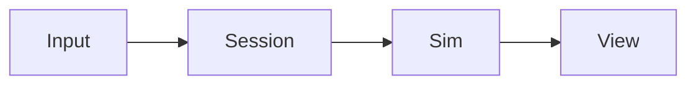

# Kestrel design docs

This site explains how Kestrel works: its engine boundaries, character and input systems, and front-end services. Start with the [step-by-step game architecture guide](architecture.md), then use the [architecture reference](architecture-reference.md) for implementation detail.

## System documentation

- [Game architecture](architecture.md) — a guided path from player input to the rendered result.
- [From a cube to a playable character](asset-walkthrough.md) — learn RON, materials, reusable geometry, rigs, motion, and player control in small steps.
- [Architecture reference](architecture-reference.md) — crate boundaries, simulation stages, networking, content, and testing details.
- [Controller support](controller-support.md) — device input, command dispatch, and platform boundaries.
- [Visual assets and characters](asset-system.md) — materials, boulder prefabs, reusable shapes, skins, motion, and Asset Studio.
- [Destructible cover](destructible-assets.md) — author breakable pieces, permanent bases, and staged repair animations.
- [Character definitions](character-definition.md) — character files, loading, and simulation use.
- [Effect definitions](effect-definition.md) — effect files: particle and light layers, inheritance, trigger parameters, and how to add and try an effect.
- [Vehicles](vehicles.md) — the rover, how players drive it, and how a vehicle fits the character framework.
- [Character animation](character-animation.md) — rig and motion behavior.
- [Service layers](service-layers.md) — front-end lifetimes and frame phases.
- [Network diagnostics](network-diagnostics.md) — egui metrics for client latency, turn delivery, and movement preview corrections.
- [Wall-clock-sensitive tests](flaky-tests.md) — known timing limits in test targets.

## Writing docs

Write new docs in Markdown. Use a descriptive `#` title, explain the system and its data flow, and link to the relevant source or test when making an implementation claim. Describe current limits and useful future capabilities directly. Keep development timelines, migration checklists, dates, and decision journals out of this site.

Use [Mermaid](https://mermaid.js.org/syntax/flowchart.html) fenced blocks for diagrams. The devserver renders them automatically:

````md

````

Run `bazel run //kestrel/docs` and open the printed local URL. Markdown, tables, and diagrams update as files change. Use relative links between docs so they work both here and in a source browser.

`bazel build //kestrel/docs:site` produces a static site under `bazel-bin/kestrel/docs/dist` from the same pinned sources and dependencies.
