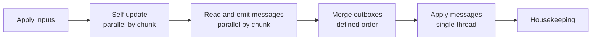

# Architecture reference

This page records the engine boundaries and invariants behind the [Game Architecture guide](architecture.md). It focuses on how components exchange data and keep a networked simulation deterministic. Feature behavior belongs in its own specification, such as [controller support](controller-support.md) or [character definitions](character-definition.md).

## Principles

- **Deterministic lockstep:** every peer runs the full simulation from the same ordered inputs. Peers exchange inputs rather than continuously streaming the world state.
- **One-way view boundary:** the Bevy front end submits commands and reads simulation output. Rendering never writes simulation state directly.
- **Fixed-point simulation:** game-rule arithmetic uses `Fx`. Raw device input is quantized before it becomes a command; rendering may use floating point.
- **Fixed tick rate:** simulation advances at 60 ticks per second. Rendering can run at another rate and interpolate between ticks.
- **Explicit ordering:** shared changes are applied in a defined order. Thread completion order cannot decide who wins a conflict.

Durations in simulation content are expressed as whole 60 Hz frames and converted at load. Rates are expressed per second. See `kestrel/content` for the field-level units and conversion functions.

## Crates

The crates are under `kestrel/` and built by Bazel. The table shows the dependency boundary, rather than every feature housed in each crate.

| Crate | Responsibility |
| --- | --- |
| `fx` | Fixed-point numbers, vectors, and deterministic math. |
| `sim` | World state, entity tables, tick stages, messages, and state hashes. |
| `content` | Authored definitions and the simulation rules hash. |
| `save` | Persisted world state and load-time remapping. |
| `net` | Turns, transport, input delay, and network test simulation. |
| `session` | Host, client, or replay orchestration around a running world. |
| `headless` | Runs the simulation without rendering for replay, tests, and benchmarks. |
| `view` | Reads render extracts and interpolates them for display. |
| `service` | Front-end service lifetimes; see [service layers](service-layers.md). |
| `play` | Minimal playable front end for sessions and networking. |
| `app` | Full Bevy game and its input and scene integration. |

The deterministic crates do not depend on Bevy. `net` receives a clock so its behavior can be tested with simulated time. `app` and `view` may use rendering types and wall-clock time because their results do not feed back into game rules.

## Simulation

### State and chunks

`sim` stores entities in per-type tables with generational IDs. The world is divided into chunks. An entity has one owner chunk at a time; ownership changes during housekeeping, outside parallel work. Chunks are the unit of parallel updates, spatial queries, message ordering, and state hashing.

Only changed chunks need their indexes and hashes refreshed. Sleeping chunks can skip update work while remaining visible to queries. These choices are performance mechanisms, but their ownership and ordering rules are also what make parallel execution deterministic.

### One tick

1. **Apply inputs:** validate player commands in player order. A player's action writes only its own avatar. Its effects on the world (depot stock, a pile haul, the memory trial, piano keys) are messages kept in command order apart from the outboxes, and stage 5 applies them before the settlement's other messages.
2. **Self update:** each entity changes only its own state. Chunks may run on different threads.
3. **Read and emit:** interactions with other entities or shared state become messages in a chunk-local outbox.
4. **Merge:** combine outboxes in a deterministic order, independent of when threads finished.
5. **Apply:** process message types and conflicts in a fixed order. A losing message is rejected rather than racing another writer.
6. **Housekeeping:** update chunk membership, indexes, timers, and hashes for the next tick.

When self update needs another entity's position, it reads a snapshot from the previous tick. Random choices use a deterministic source keyed by simulation state. A message generated during apply waits until the next tick.

### Fixed-point math

`Fx` is an `i64` value in 32.32 format. Parsing authored decimals, square root, and trigonometry use deterministic implementations rather than platform floating-point functions. The golden tests in `kestrel/fx` check their results over fixed inputs.

## Networking

The host collects commands and publishes the official input list for each tick. A client advances that tick only after it has the turn. Input delay schedules a newly made command far enough ahead to travel to the host. Peers compare state hashes to detect a divergence.

The protocol sits above a `Transport` interface for sending and receiving messages. The loopback transport and virtual clock let tests inject latency, jitter, and loss without waiting on real time. Direct UDP is another transport. The turn protocol uses datagrams so a lost packet does not hold back every later turn behind a reliable byte stream.

A joining peer starts from a save and the inputs since that save. The session also owns transitions between loaded worlds. A session ends when its host leaves; platform lobby backends are not present in the current implementation.

## View (Bevy)

The front end turns device input into quantized commands. After each simulation tick, it reads a render extract containing the state needed to draw the world. It can interpolate between extracts and play tick-tagged effects. The view may use floating point and non-deterministic visual effects because those values do not change simulation state.

The boundary lets the simulation run without a renderer in tests and allows rendering work to change independently of game rules. [Controller support](controller-support.md) defines device-to-command behavior.

## Data

Four data forms cross different boundaries:

| Form | Role |
| --- | --- |
| Content | Authored definitions. Simulation fields contribute to the rules hash; presentation fields do not. |
| Scenario | Starting setup used to create a world. |
| Save | Simulation state at a particular tick, used for loading and joining. |
| Input log | Ordered turns after a save, used for replay and diagnosis. |

Files use names for authored content; runtime tables can use compact indices. A save carries the names needed to remap those indices when loaded. A peer must have the same simulation rules to join a lockstep session.

## Verification

The architecture is checked at its boundaries: fixed-point golden values, matching state hashes across thread counts, replaying the same save and inputs, continuing from a saved tick, and network runs with simulated latency and packet loss. `kestrel/headless` provides the renderer-free path for these checks. Performance is measured as time per tick under a specified world and machine load; it is not a gameplay rule.
