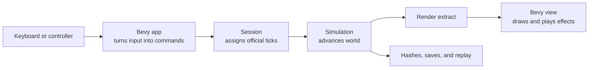
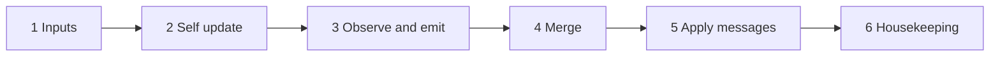

# Game architecture

Kestrel is a cooperative game with three parts that have different jobs. The **simulation** decides what happens in the world. The **view**, built with Bevy, draws that world and collects player input. A **session** keeps players on the same sequence of simulation ticks.

This guide follows one player action through those parts. For crate boundaries, data formats, and timing rules, see the [architecture reference](architecture-reference.md).

## First, four terms

| Term | Meaning |
| --- | --- |
| Tick | One fixed step of game time. The simulation runs at 60 ticks per second. |
| Command | A player's requested action, such as moving an avatar or attacking. It contains game values rather than device events. |
| Peer | One player's running copy of the game. In a network game, each peer simulates the full world. |
| Render extract | A read-only snapshot of simulation results that the view can draw. |

The key boundary is simple: the view **sends commands** to the simulation and **reads extracts** from it. Drawing code does not directly change game state.

## Follow one movement action

Imagine a player pushing a stick to move their avatar.

1. **The app reads the device.** Bevy receives controller or keyboard input. The input layer turns it into movement intent and quantizes it into a simulation command such as `MoveAvatar`. The simulation never reads a gamepad or keyboard itself. See [controller support](controller-support.md) for the device mapping.
2. **The session assigns a tick.** In a network game, the command is scheduled for a future tick to allow time for it to reach the host. The host collects players' commands and sends the official list of inputs for that tick to the other peers. The same session interface also supports local play and replay.
3. **Every peer advances the same world.** Once it has the official inputs, each peer runs the simulation for that tick. Movement, collisions, and other game rules use fixed-point math and a defined update order. Given the same starting world and commands, peers must get the same result.
4. **The view draws the result.** The simulation produces data such as positions and animation state. The view converts those values for rendering, interpolates between ticks for smooth motion, and plays visual or audio effects. Rendering may run at a different rate from the simulation.
5. **The result can be checked or replayed.** A state hash helps detect peers that disagree. A save plus the subsequent input log can reproduce a run without recording video or copying the entire world every tick.

For a local game, the same boundaries still matter: the simulation remains independent of rendering, and recorded commands can be replayed.

## Why the simulation is separate

Network peers exchange **inputs**, not a continuous stream of world positions. This is called deterministic lockstep. It keeps network traffic small, but it requires every peer to make the same decision at every tick. A difference in arithmetic, random numbers, or update order would make their worlds diverge.

Kestrel therefore uses fixed-point `Fx` values for simulation math, a seeded deterministic random source, and a fixed order for applying shared changes. Bevy can use floating point, wall-clock time, and visual randomness because those choices do not feed back into simulation state. The [architecture reference](architecture-reference.md#principles) gives the precise rules and timing conventions.

## What happens inside one tick

A tick has six stages. The separation lets chunks of the world run in parallel without letting thread scheduling change the outcome.

| Stage | What it does |
| --- | --- |
| 1. Apply inputs | Validate and apply the players' commands in player order. |
| 2. Update each entity | Move or advance an entity using data it owns; chunks can run in parallel. |
| 3. Observe and emit | Detect interactions and write messages into each chunk's outbox. |
| 4. Merge messages | Combine outboxes in a deterministic chunk order. |
| 5. Apply messages | Resolve shared changes, such as damage or stock transfers, in a fixed order. |
| 6. Housekeeping | Move entities between chunks and refresh changed indexes and hashes. |

For example, a projectile can move itself in stage 2. If it hits a target, stage 3 emits a damage message. Stage 5 applies that damage. The projectile does not directly change another entity while chunks are running in parallel.

The [simulation reference](architecture-reference.md#simulation) covers chunk ownership, message ordering, and deterministic math. Feature specifications describe their own gameplay rules.

## Find the code by responsibility

| If you are working on… | Start with… |
| --- | --- |
| Game rules, entities, or tick stages | `kestrel/sim` |
| Fixed-point values and math | `kestrel/fx` |
| Authored character and scenario data | `kestrel/content` |
| Turns, transports, or network timing | `kestrel/net` and `kestrel/session` |
| Saves or replay inputs | `kestrel/save` and `kestrel/headless` |
| Rendering and interpolation | `kestrel/view` |
| Scenes, input, and the full game | `kestrel/app` |

The [crate table](architecture-reference.md#crates) explains each package, and the sections on [networking](architecture-reference.md#networking), [view](architecture-reference.md#view-bevy), [data](architecture-reference.md#data), and [testing](architecture-reference.md#testing) explain their contracts.

## Read next

- [Controller support](controller-support.md) traces physical input into commands.
- [Character definitions](character-definition.md) explains authored character gameplay rules.
- [Visual assets and characters](asset-system.md) follows materials and geometry into prefabs, skins, and the running game.
- [Architecture reference](architecture-reference.md) describes the engine contracts.
