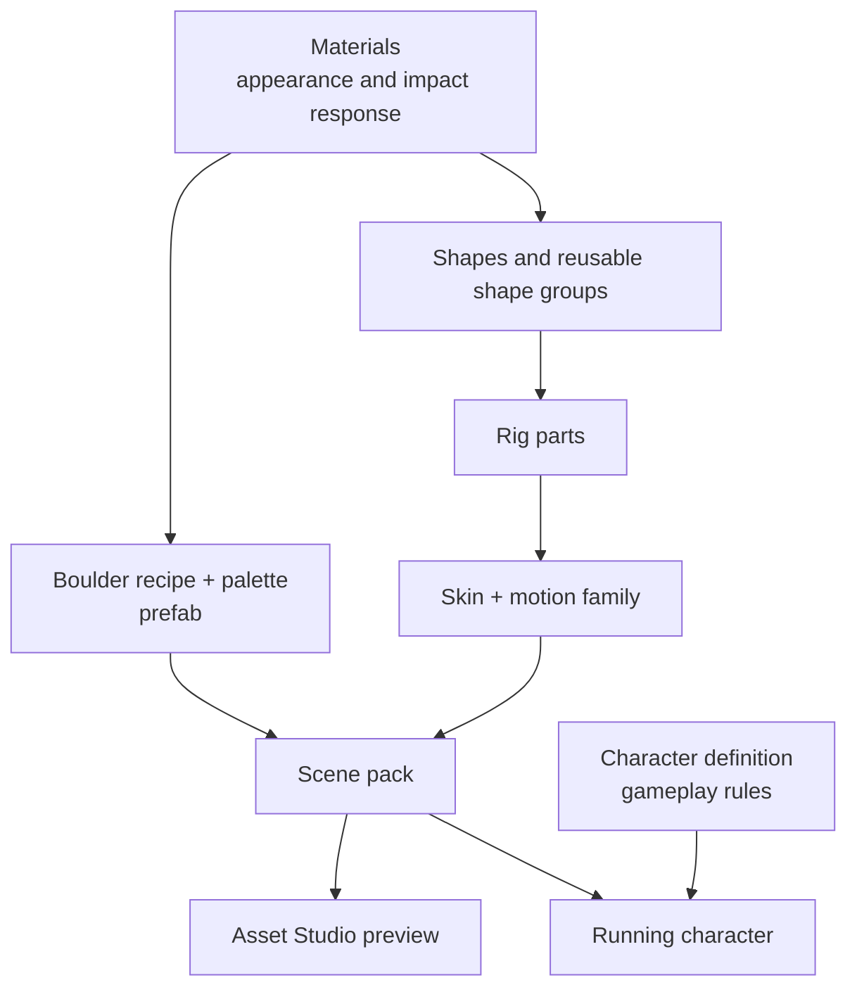

# Visual assets and characters

For a gradual introduction with a real scene and screenshots, start with [From a cube to a playable character](asset-walkthrough.md). This page is the reference for the asset paths and current boundaries.

Kestrel builds visible objects from authored materials and geometry. A boulder and a ghoul take different routes through that system: the boulder is a **prefab** placed in a scene, while the ghoul is a **skin** attached to a moving rig. Their gameplay rules live elsewhere.



The arrows show current build and runtime relationships, not a single universal asset-file schema. In particular, a character definition does not yet name its skin.

## Which RON file describes which thing?

Each row below is a **different schema**. A path is an example source file, not a field to put inside another RON file.

| Source | Outer RON value | What it defines |
| --- | --- | --- |
| `assets/palette.ron` | `Palette(materials: [...])` | Four named boulder surface materials, in slot order. |
| `assets/prefabs/ore_small.ron` | `Boulder(...)` | One generator recipe: shape parameters, not placement. |
| `assets/levels/boulder_lab.ron` | `Scene(..., instances: [...])` | Placement of prefab IDs in a scene. |
| `assets/styles/combat.ron` | `Style(..., materials: [...], shape_groups: [...], skins: [...])` | A scene's named materials, reusable shapes, actor parts, and skins. |
| `content/data/character/ghoul.ron` | `(sim: (...), view: ())` | Rules for one character kind; see its [complete schema](character-definition.md). |

The `assets/` paths above are under `kestrel/app/`. Bazel connects the recipe and palette into a prefab, then connects prefabs, a scene layout, and an optional style into a scene pack. A RON file does not import another one by itself.

## 1. Materials give surfaces their properties

A material has a name, color, emissive color, metallic and roughness values, and an impact response such as `Stone` or `Metal`. Geometry refers to materials by name; the material itself has no shape. Style files such as `kestrel/app/assets/styles/combat.ron` hold named materials for their scene's architecture and skins.

Boulder prefabs use a four-slot palette instead: base, dark, light, and ore. A palette can be authored directly, as in `kestrel/app/assets/palette.ron`, or derived from a style. The boulder generator chooses a slot for each exposed surface. A palette is therefore part of the boulder's appearance, not a recipe for combining four materials into a new material.

## 2. A boulder recipe becomes a scene prefab

For example, `ore_small.ron` contains a single boulder recipe:

```ron
Boulder(seed: 0, radius: 0.85, height: 1.25, voxel_size: 0.31)
```

Other generator settings use defaults. The asset compiler combines this recipe with a palette to produce a **prefab**: geometry, materials, and collision information under one ID. Baked prefabs store meshes; runtime prefabs store a validated recipe and generate equivalent meshes when the scene loads.

A scene layout places instances by prefab ID, position, optional yaw, and optional scale. For example, two entries in `boulder_lab.ron` both name `ore_small`; one has a larger scale. A runtime boulder instance may override allowed recipe parameters, such as its seed. The scene pack carries its prefabs and placements into the game.

Prefabs currently do **not** contain other prefabs. Scene layouts compose a scene from multiple prefab instances, but there is no reusable nested prefab with child transforms yet.

## 3. Reusable shapes become rig parts and skins

A style's `shape_groups` are named collections of voxel shapes in local coordinates. A group may include other groups. Actor and skin **parts** include groups and can add their own shapes. The compiler expands the groups before meshing and validates names, cycles, and size limits. The combat style, for example, uses one `ghoul_leg` group for both legs of the ghoul and armored ghoul.

The following is an excerpt **inside a `Style(...)` file**. It is not a standalone RON file:

```ron
shape_groups: [
    (id: "boot", shapes: [
        (kind: Box, position: (0.0, -0.5, 0.1),
         size: (0.2, 0.1, 0.3), material: "leather"),
    ]),
    (id: "leg", includes: ["boot"], shapes: [
        (kind: Box, position: (0.0, -0.25, 0.0),
         size: (0.2, 0.5, 0.2), material: "cloth"),
    ]),
],
skins: [
    (id: "walker", scale: 0.55, motion: Biped, parts: [
        (part: LeftLeg, includes: ["leg"]),
        (part: RightLeg, includes: ["leg"]),
    ]),
],
```

These groups are reusable **within one style**. They have no independent file of their own. A `Scene(...)` can place a group through `shape_instances: [(group: "leg", position: (1.0, 0.5, 0.0), scale: 1.0)]`, or an actor or skin part can include it in local coordinates. A skin can remap its material names after expansion. This composes shapes; it does not yet nest arbitrary boulder prefabs.

## 4. Motion makes some skins animated

A skin assigns meshes to named rig parts and declares a motion family: `Biped`, `Quadruped`, `CubeRoll`, `Vehicle`, `Machine`, `Turret`, or `Static`. The runtime rig poses those parts using the selected family's procedural motion. `Biped` expects left and right leg parts and uses their pivots and mesh bounds for gait and foot contact; `CubeRoll(edge: ...)` expects a body centered half an edge above the floor. Walk, run, jump, and attack previews sample pose functions; skins do not contain authored keyframe clips. The [cube walkthrough](asset-walkthrough.md#what-biped-expects) shows both motion contracts; the [animation guide](character-animation.md) explains how poses and gameplay actions meet.

An animated skin is not automatically a gameplay character. A cart may use vehicle motion, for example, without using the character-definition schema. Conversely, a character's gameplay definition specifies movement, health, and behavior but currently has an empty `view` section. See [character definitions](character-definition.md) for that schema and its limits.

## Inspecting the result

The launch menu's **Asset Studio** previews player actors, baked skins, and scene prefabs such as boulders. A skin appears whenever it has baked geometry; its motion type determines which movement previews are available. Select a prefab to see its geometry and material names. The Studio is an inspection tool today; authoring happens in RON files and Bazel asset targets. `kestrel/build/voxel_assets/README.md` describes the compiler inputs and generated scene packs.
