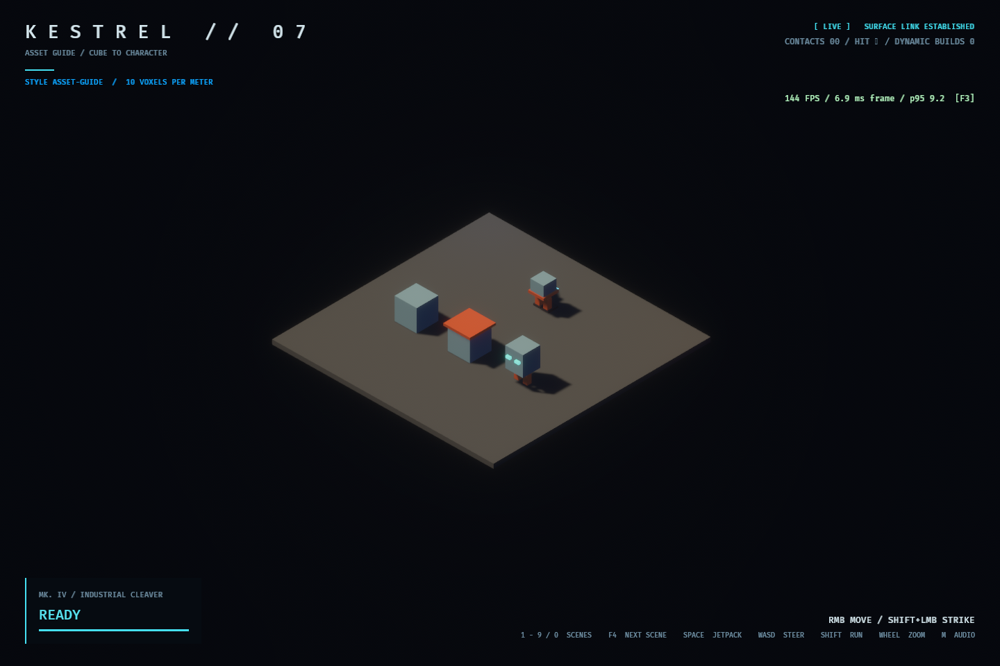
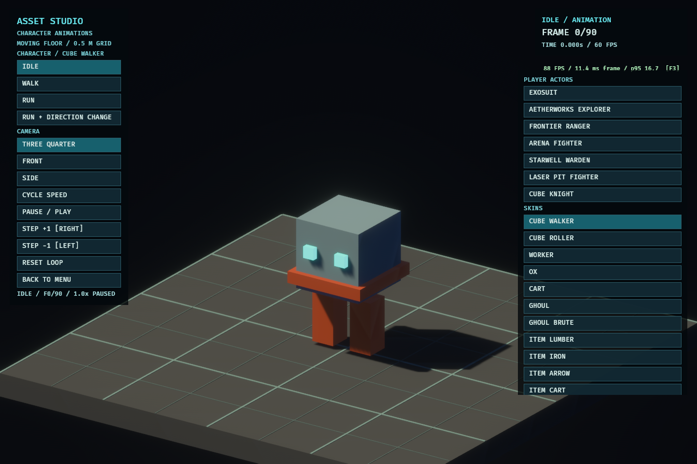
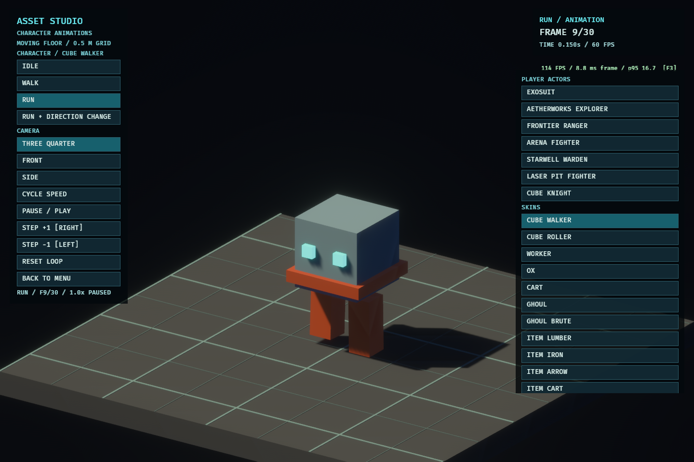
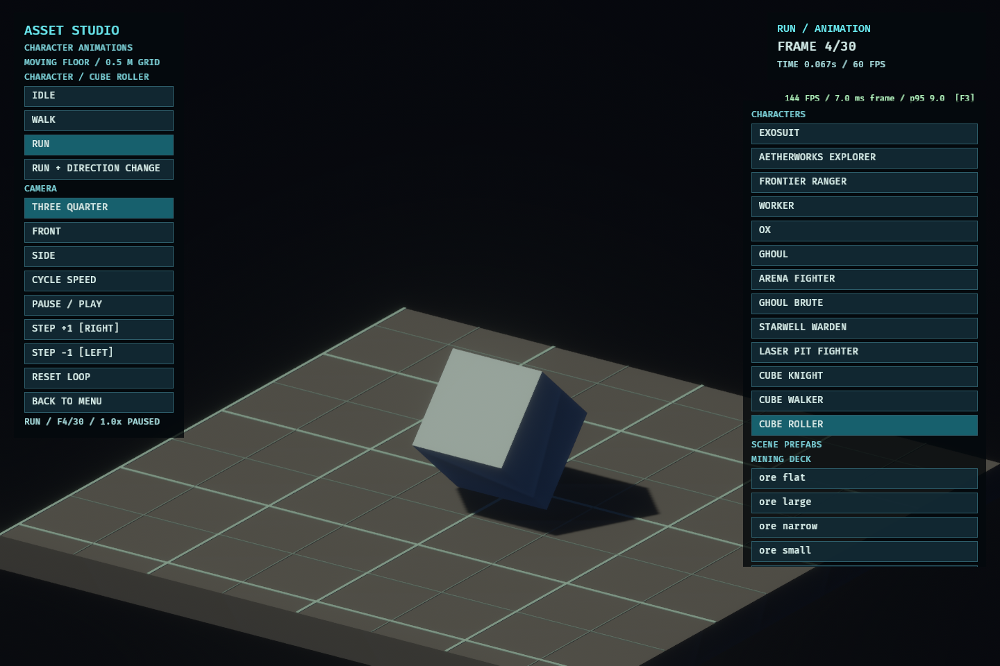
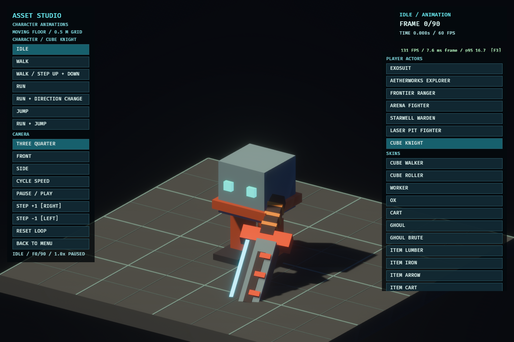
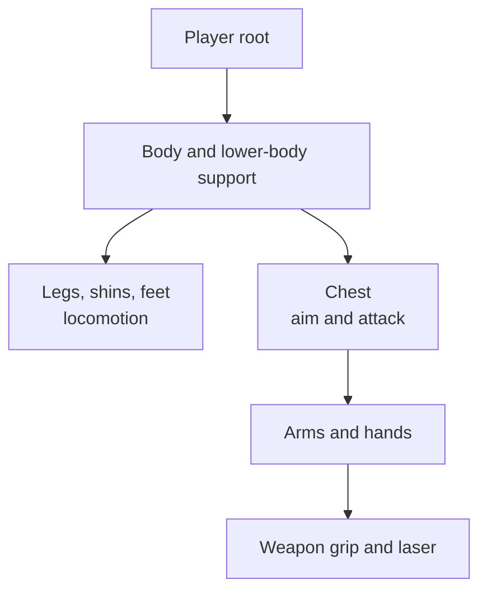

# From a cube to a playable character

This guide grows one visual idea in small steps. The **Asset Guide** scene shows the progression from left to right: one cube, a cube with a second material, and a body assembled from several shapes. Its player avatar uses the same building blocks on a moving rig.

Run `bazel run //kestrel/app:demo -- --scene asset-guide` to explore it, or open **Asset Studio** from the launch menu. **CUBE KNIGHT** is the playable actor; **CUBE WALKER** (`skin:cube_walker`) is the inspectable, unarmed skin made from the same authored body parts. **CUBE ROLLER** (`skin:cube_roller`) shows another way to move a cube.



## 1. Describe one cube

The first object is one entry inside a scene's `architecture: [ ... ]` list:

```ron
(kind: Box, position: (-2.4, 0.5, 1.0),
 size: (1.0, 1.0, 1.0), material: "stone")
```

This also introduces the RON syntax used throughout the asset files:

- Parentheses hold a record of named fields: `kind: ...`, `size: ...`.
- Commas separate fields and list entries. Square brackets hold lists.
- `Box` is an enum choice and is written without quotes. `"stone"` is a string name and is quoted.
- The three numbers in `position` are x, y, and z in meters. The three in `size` are its width, height, and depth.
- `//` starts a comment. Optional fields can be omitted when their schema supplies defaults; an optional value may be written as `Some(...)` in files that use that form.

This record is a **shape**, not a complete asset file. It needs an owner, here a `Scene(...)` layout, and a material named `stone` in that scene's style. The file's outer type tells the loader which schema to use. [Visual asset reference](asset-system.md#which-ron-file-describes-which-thing) maps the file types.

## 2. Give the cube a material

The style file defines what `stone` looks and sounds like when struck. The Asset Guide uses this material record inside `Style(materials: [ ... ])`:

```ron
(name: "stone", color: (0.35, 0.55, 0.65),
 emissive: (0.0, 0.0, 0.0), metallic: 0.1,
 roughness: 0.7, impact: Stone)
```

The name links the cube to the material. `color`, `emissive`, `metallic`, and `roughness` affect appearance; `impact` selects a response such as stone or metal. The middle object keeps its stone body and adds a thin copper cap. That is **two shapes referring to two materials**, not a new blended material.

## 3. Reuse shapes to make a more complex asset

Writing every box again for each character would duplicate geometry. A `Style(...)` can instead name a group of shapes. Here are excerpts from the Asset Guide style:

```ron
shape_groups: [
    (id: "cube", shapes: [
        (kind: Box, position: (0.0, 0.0, 0.0),
         size: (0.6, 0.6, 0.6), material: "stone"),
    ]),
    (id: "face", shapes: [
        (kind: Box, position: (-0.15, 0.04, 0.31),
         size: (0.09, 0.09, 0.03), material: "glow"),
        (kind: Box, position: (0.15, 0.04, 0.31),
         size: (0.09, 0.09, 0.03), material: "glow"),
    ]),
    (id: "character_body", includes: ["cube", "face"], shapes: [
        (kind: Box, position: (0.0, -0.19, 0.0),
         size: (0.68, 0.08, 0.68), material: "copper"),
    ]),
],
```

`includes` composes named groups within the same style. The compiler expands them before meshing, and rejects unknown names or cycles. A group alone has no location. The guide scene places `character_body` and two copies of `leg` through `shape_instances`; the actor below reuses those same groups as moving rig parts.

```ron
shape_instances: [
    (group: "character_body", position: (2.4, 0.94, 1.0), scale: 1.4),
    (group: "leg", position: (2.18, 0.56, 1.0), scale: 1.25),
    (group: "leg", position: (2.62, 0.56, 1.0), scale: 1.25),
],
```

These entries are inside `Scene(...)`. The group names resolve against that scene's `Style(...)`. Position and scale belong to each placement, while geometry and material names stay in the reusable group.

## 4. Put the asset on a rig

A moving body needs separate **parts** with pivots. The style attaches the composed body and the two legs to the player rig:

```ron
actor: [
    (part: Body, pivot: Some((0.0, 0.85, 0.0)),
     includes: ["character_body"]),
    (part: LeftLeg, pivot: Some((-0.18, 0.48, 0.0)),
     includes: ["leg"]),
    (part: RightLeg, pivot: Some((0.18, 0.48, 0.0)),
     includes: ["leg"]),
],
```

The `leg` group is defined once and used twice. `pivot: Some(...)` gives each part a joint origin; the shapes remain in that part's local coordinates. The rig moves parts relative to their parents. Parts without authored meshes can use procedural fallback geometry.



## 5. Choose how the rig moves

The same style also makes an inspectable **skin**, meaning a named visual rig, from its actor parts:

```ron
skins: [
    (id: "cube_walker", scale: 1.0,
     motion: Biped, use_actor: true),
],
```

`Biped` selects the existing two-legged procedural motion. `use_actor: true` reuses the actor's meshes. In Asset Studio, selecting `cube_walker` and **RUN** shows the rig being posed over time. RON does not contain a walk keyframe sequence here: the engine computes the pose from movement state and motion settings. Static objects, vehicles, machines, and quadrupeds have other motion families.



### What `Biped` expects

`motion` is a choice in the skin schema, implemented by the engine's rig posing code. The interface between a skin and `Biped` is its set of named parts:

| Part | How `Biped` uses it |
| --- | --- |
| `Body` | The center of the rig; it can lean with activity, injury, or recoil. |
| `LeftLeg`, `RightLeg` | They swing in opposite phases as travel distance grows. Their pivots locate the hips. |
| `LeftShin`, `RightShin`, knees, feet | Optional extra joints follow the gait. |
| Arms and hands | Optional parts swing while moving. |

The compiler bakes each part's shapes into a mesh and keeps its pivot. At runtime, the rig measures the bottom of each leg mesh. For legs with suitable geometry, `Biped` uses those measurements to plant the foot during the contact half of a step and lift it during the other half. Missing optional parts simply have nothing to pose. The player actor has a related procedural pose system for its combat and control rig; `motion: Biped` here selects motion for a **skin**.

### A cube that rolls instead

A cube has no legs, so a walking rig is the wrong contract. The guide style defines a separate skin with one `Body` part:

```ron
(id: "cube_roller", scale: 1.0,
 motion: CubeRoll(edge: 0.6),
 parts: [
     (part: Body, pivot: Some((0.0, 0.3, 0.0)),
      includes: ["cube", "face"]),
 ])
```

`CubeRoll` rotates the body a quarter turn for each `edge` of forward travel. It raises the center during each turn so a corner stays on the floor. The `Body` pivot starts half an edge above the floor; its shapes are centered around that pivot. Select **CUBE ROLLER** and **RUN** in Asset Studio to see it. The style author supplies the geometry, pivot, and edge length; the engine supplies the pose rule. Adding a different motion family requires a new motion choice in the asset schema, validation for its parameters, and a pose rule that maps travel and activity to named parts.



## 6. Make a player control it

A player needs both a visual rig **and** gameplay rules. In this scene, `Style.actor` supplies the visible body. The built-in `exosuit` character definition supplies the controllable `Player` brain, collision radius, movement speeds, and attack timing:

```ron
// From content/data/character/exosuit.ron
sim: (
    brain: Player,
    body: (radius: 0.32),
    movement: (walk: 3.8, run: 5.6),
    // avatar contains acceleration and attack timing.
),
view: (),
```

This is an excerpt, not a complete character file; [character definitions](character-definition.md) gives the full schema. The scene chooses its actor style, while the character file chooses gameplay behavior and, in `view.motion`, how the rig poses. A player's `view` names no skin: the scene's actor draws it. Other characters, such as `ghoul`, name the skin that draws them with `view: (skin: "ghoul")`. Giving a skin `motion: Biped` does not by itself make it controllable.

**CUBE KNIGHT** also shows a sword because the player rig supplies one when the style has no authored `Weapon` part. That sword is built from geometry in the player rig code; it is not a separate RON asset in this scene. Other styles can author a `Weapon` part, and a style can map weapon types to skin meshes, but there is no standalone sword asset that styles can reference across files yet. The body groups above are reusable within this style; weapon reuse across styles remains a gap in the asset system.



## A more complicated character: the laser fighter

The laser scene shows why a character is more than one animated mesh. Its player rig has a **Body** branch for support and legs and a **Chest** branch for head, arms, and weapon. Moving and aiming can affect these branches independently. While firing the laser, the engine preserves the lower body's locomotion pose and applies the attack to the upper body.



The laser style currently authors the **weapon mesh and muzzle**; it tunes natural motion and planted feet, while the rest of the player rig uses procedural fallback geometry. This is why partial styles are supported. A style can replace Body, Chest, legs, or weapon meshes without having to replace the entire rig. [Character animation](character-animation.md) covers the pose rules in detail.
