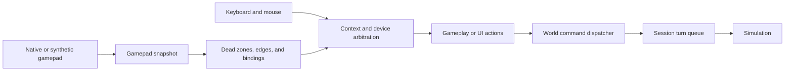

# Controller support

The front end turns controller input into the same simulation commands used by keyboard and mouse. Device identities, analog values, dead zones, and UI navigation stay outside the deterministic simulation. The current native gamepad backend is available on Windows; synthetic input supports automated tests without a physical controller. Physical USB-controller behavior has not been validated.

## Input path

`InputService` samples devices once per frame. It owns the selected controller seat, input history, bindings, and context consumption. UI navigation and confirmation are resolved before gameplay dispatch, so one press cannot activate both a menu and an in-world action. `PlayerControl` remains World-scoped: it resolves gameplay actions against the current avatar and creates `sim::CommandKind` values. The service phases remain Input, Step, Mirror, and Present; see [service layers](service-layers.md).

The native reader and synthetic test source both produce `GamepadSnapshot` values. They share filtering, edge detection, claiming, ownership, and disconnect behavior. Snapshot identities do not enter commands or saves.

## Default bindings

| Control | Gameplay | UI |
| --- | --- | --- |
| Left stick | Camera-relative movement | Move focus |
| Right stick | Independent aim | — |
| LB | Hold run | — |
| RB | Jump in Jump scenes; hold jetpack otherwise | — |
| RT | One attack per press | — |
| A | Interact with selected target | Confirm |
| X | Collect compatible material while carrying | — |
| B | Propose a nearby cargo drop | Back or cancel chooser |
| Y | Cycle available weapons | — |
| D-pad left/right | Cycle nearby targets | Move focus |
| D-pad up/down | Zoom camera | Move focus |
| View | Open utility panel | Close utility panel |
| Menu/Start | Claim controller or open pause | Pause or resume |

The utility panel exposes available Dig, Record/Deploy, Clear Recording, Respawn, and Cancel Logistics actions. Menus and choosers support focus navigation. Text fields still use keyboard editing.

## Seat and ownership

Menu/Start claims the one local controller seat. The claim press is consumed; other controllers are ignored until the seat is released. A disconnect releases the seat and suspends direct control.

Keyboard/mouse and the selected controller are two gameplay device groups. The last **deliberate** input takes ownership of the whole gameplay input set. Stick noise and passive mouse drift do not count. When both groups act in one frame, the current owner wins. Takeover releases outgoing movement and thrust before applying incoming actions. Neutral input from the non-owner cannot send Stop.

Pause, focus loss, or controller disconnect sends `ReleaseDirectControl` for the local avatar. It stops manual movement and thrust and clears unsent input edges. An already accepted logistics job continues under simulation rules. Input must return to neutral before it can contribute after suspension; reconnecting or regaining focus does not silently resume play.

## Movement, aim, and attack

The left stick passes through a radial dead zone with hysteresis, then produces a unit direction in the camera-relative horizontal plane. Run is a separate held action. Continuous movement and aim commands are coalesced, while press, release, and cancel edges retain their order.

The right stick sets aim independently of travel. When it returns to neutral, the last valid world-space aim remains. Aim is initialized from confirmed avatar facing on world entry or respawn. If aim and attack arrive in one sample, aim is resolved first. Targeting uses confirmed simulation state rather than an interpolated pose.

RT fires once when it crosses its press threshold. It must fall below a separate release threshold before another attack. Holding RT does not repeat attacks. RB jump is a press edge; jetpack is held state with release and cancellation. Quantization to `Fx` happens at the command boundary.

## Nearby interactions

The controller selects a nearby eligible target instead of moving a virtual cursor. Selection remains on a target while it is valid; D-pad left/right cycles candidates in stable ID order. Candidates are filtered by distance, floor, and local reachability. Simulation validation remains authoritative, so the UI reports a rejection rather than silently substituting another target.

A interacts with the selected pile, depot, collector, dispenser, or machine according to the available action. A chooser handles multiple item types. X collects more compatible material. B previews a cargo drop ahead of confirmed facing. New deliberate movement cancels an accepted approach job; merely entering a UI context does not. Explicit Cancel Logistics is a separate action.

## Platform and verification boundaries

The Windows native reader maps Bevy gamepad buttons and axes to snapshots. Linux and browser builds have no native controller backend. Synthetic scenarios exercise claiming, takeover, dead zones, aim, attack edges, menus, logistics, pause, disconnect, replay, and different render rates without hardware. Native mapping has a code-level test; physical discovery, button feel, and disconnect behavior on a USB controller remain unverified.

| Concern | Source |
| --- | --- |
| Snapshot filtering and synthetic input | `kestrel/app/src/input/pad.rs`, `synthetic.rs` |
| Seat, contexts, and arbitration | `kestrel/app/src/input/mod.rs` |
| Native reader | `kestrel/app/src/input/native.rs` |
| Targets and gameplay commands | `kestrel/app/src/input/targets.rs`, `gameplay.rs` |
| UI prompts and panels | `kestrel/app/src/input/hud.rs` |
| Authoritative release behavior | `kestrel/sim/src/settlement/avatar.rs` |
