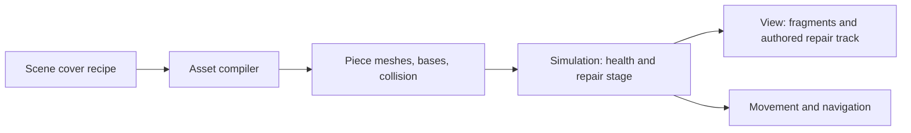

# Destructible cover

The laser arena uses cover made from independently breakable pieces. A laser or projectile stops at the first solid piece it reaches. Each hit reduces that piece's health by one and visibly reduces its body. On the final hit, the piece tumbles or shatters into fragments and a dust ring spreads from the break. Fragments bounce, rest on the floor for a few seconds, then fade away. Other pieces in the same bunker remain, so the result follows the shot location.

Some cover is repairable. Its floor base remains visible and blocks movement after the body breaks. Walk within reach of a damaged base and hold **R** to rebuild it. Each second restores one damage stage, so the body returns in steps. Leaving its reach or releasing R resets progress toward the current stage, while completed stages remain repaired. Other cover has no base: breaking it opens a path. Damage and repair state persist in saves and lockstep replays.



Each piece has a stable index and its own health. A hit affects the piece at the contact point, so a bunker can have broken and intact parts at once. At zero health, an ordinary piece stops blocking movement; a repairable piece retains the collision of its floor base. Repair animations change how a piece looks as it rebuilds, but never change the repair rate or the collision rule.

## Authoring a bunker

Add a `destructibles` entry to a `Scene(...)` RON file:

```ron
destructibles: [
    (position: (0.0, 0.75, -0.4), size: (1.8, 1.5, 1.8),
     material: "shadow", trim: Some("trim"), pieces: (2, 2), health: 3,
     form: Stepped, break_style: Shatter, repairable: true),
],
```

`position` is the center of the cover, in scene meters. `size` gives its width, height, and depth. `material` and optional `trim` name materials in the scene style. `pieces` splits the cover across its width and depth, so `(2, 2)` creates four independent pieces. `health` is the number of hits each piece survives. The laser arena gives some bunkers two hits per piece and others three.

`form` controls the authored shape of each piece. `Armored` has a narrow shell between an overhanging plinth and lid, with a thin face band; `Pylon` uses a round base and shaft under a tapered crown; `Stepped` has a lower base and narrower upper tier. `break_style` controls the visual response: `Topple` launches the remaining body and several chips, while `Shatter` breaks it down as more fragments scatter. Both choices share collision, health, save, and replay behavior. The laser arena combines metal bunkers and pylons with stepped dark cover.

Set `repairable: true` to give every piece in the cover its own permanent base and held-R repair. Omit it for cover that opens a passage when destroyed.

Each asset can author its own `repair_animation` track. Keyframes run from `at: 0.0` (destroyed) to `at: 1.0` (fully restored); `scale` and `offset` control how the body grows from its base. The engine interpolates between keyframes as repair progresses, including between completed health stages. A repairable asset without a track uses an upward build animation. For example, the laser arena's pylon starts as a narrow core, widens at half health, and reaches its full shape at the final stage:

```ron
repair_animation: Some((keyframes: [
    (at: 0.0, scale: (0.15, 0.05, 0.15), offset: (0.0, 0.0, 0.0)),
    (at: 0.5, scale: (0.55, 0.65, 0.55), offset: (0.0, 0.0, 0.0)),
    (at: 1.0, scale: (1.0, 1.0, 1.0), offset: (0.0, 0.0, 0.0)),
]))
```

This is a field inside a destructible cover entry. Keyframes must start at `0.0`, end at `1.0` with the full body transform, and have increasing `at` values. The authored track affects the view only; repair timing and collision remain deterministic simulation state.

The asset compiler bakes each piece as its own mesh and supplies a matching collision disc. Repairable pieces also get a separate floor base mesh. The simulation keeps the pieces in a stable order and owns health and repair progress. Movement and navigation treat repairable bases as solid even at zero health; beams and projectiles strike only surviving bodies. The view reads health to launch visual fragments and restore repaired bodies. A loaded save starts with the correct body and base visibility, without replaying old destruction animations.

The current recipe describes segmented cover with three authored forms. It does not yet fracture arbitrary meshes into exact geometric shards.
