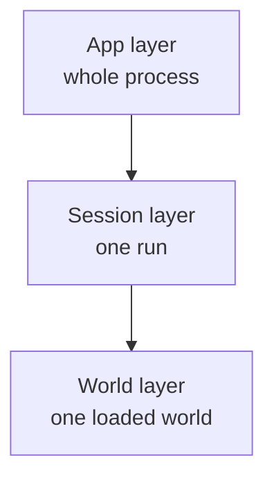
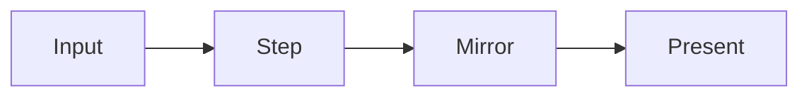

# Front-end service layers

The Bevy front end groups resources and systems by lifetime. A service belongs to one of three layers: **App**, **Session**, or **World**. Lower layers start before higher layers and stop after them. This structure applies to front ends such as `kestrel/app`; the deterministic simulation does not depend on Bevy services.

## Lifetimes

| Layer | Lifetime | Typical responsibilities |
| --- | --- | --- |
| App | The running process | Menu flow, device input, shared assets, sound, and telemetry. |
| Session | One local, hosted, joined, or replayed session | Connection, turn clock, input log, pause state, and the current world slot. |
| World | One loaded simulation world | Input-to-command dispatch, render mirrors, scene entities, camera, effects, and HUD. |

A session can exist with no world loaded. Loading another world replaces the World layer while leaving the Session layer alive. This keeps connection and turn history separate from scene entities and view state.

## Service contract

A service is a singleton Bevy resource implementing `service::Service`. It declares its layer and dependencies, initializes when its layer starts, can report readiness while loading, and shuts down when the layer stops. A service may depend on another service in its own layer or a lower layer. Dependencies in the same layer must be registered earlier.

`AppState` has Loading and Active states. `SessionState` and `WorldState` also have Off. A layer enters Active when its services report ready. Entities marked `SessionScoped` or `WorldScoped` are removed when their layer stops, after its services shut down.

The code is in `kestrel/service/src/lib.rs`. The full game registers its services in `kestrel/app/src/main.rs`.

## One frame

Services run in four ordered phases inside Bevy's Update schedule:

| Phase | Purpose |
| --- | --- |
| Input | Read devices and scripts, resolve actions, queue simulation commands. |
| Step | Advance the session, network, and due simulation ticks. |
| Mirror | Copy confirmed simulation results into front-end view state. |
| Present | Update rigs, effects, camera, and HUD. |

Within each phase, App services run before Session services, then World services. Services in one layer run in registration order. Systems within one service may still run in parallel. Input precedes Step so a command queued this frame can be included in a tick due this frame.

## Commands cross the boundary

The input layer interprets raw keyboard, mouse, or controller state as actions. World-scoped control code resolves those actions against the current camera and avatar and creates `sim::CommandKind` values. The Session layer queues the commands for an authoritative tick. Only commands enter the deterministic simulation; UI actions and device state stay in the front end. See [controller support](controller-support.md) for the device path and [Game Architecture](architecture.md) for the full input-to-view path.
