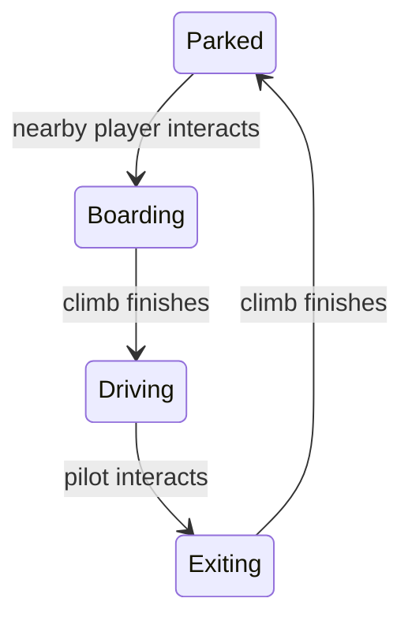

# Vehicles

A vehicle is a scene object that a player can enter and drive. The parked mech in **Blackout Hall** is the first vehicle. Walk close to it and press **E** (or the controller's interact button) to board. The hatch opens while the character climbs into the cockpit; once seated, the mech follows the usual movement, run, aim, and fire controls. Press the same interact control to climb out. The game shows a prompt when boarding is available.

The mech is about two and a half times the height of the player. It walks and runs faster, has a wider body for collisions, and fires its own larger laser. The laser deals twice the normal damage to enemies and cover. The mech remains in the scene after its pilot exits.

## Place a vehicle

Add a vehicle entry to a scene's `Scene(...)` RON value:

```ron
vehicles: [
    (id: "guardian-mech", kind: Mech, position: (-3.5, 0.0, 10.4), yaw: 0.0),
],
```

`id` is unique within the scene. `position` is the mech's parked location in scene coordinates; `yaw` faces its front. The current `kind` value is `Mech`. A scene may place several mechs, and each has its own seat. A player can board only a nearby empty mech.

## How control changes



These phases belong to the shared simulation. Movement and attacks pause during boarding and exit. While driving, normal movement input controls the mech's position and heading, and the player's avatar occupies its seat. Other players see the same hatch, moving mech, and laser because each client follows the shared phase and position. The player emerges beside the mech at a clear, walkable spot.

The mech's articulated model is generated by the game view from the `Mech` kind. The simulation owns occupancy, timing, movement size, and weapon strength; the model and hatch animation are presentation. The vehicle entry is a different scene schema from a prefab or a character skin. See [Visual assets and characters](asset-system.md) for those schemas.
