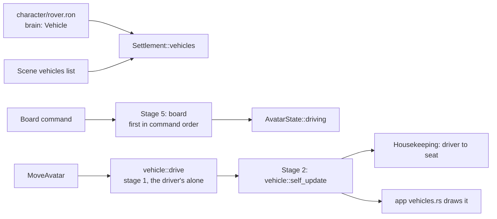

# Vehicles

A vehicle is a character a player climbs into and drives. The dig lab parks a mining **rover** beside the spawn: walk up to it and press **G** (or click the left stick) to climb in, steer with the movement controls, hold run to boost, and press G again to climb out. The rover rolls up the mine's quarter-meter terraces and out of a one-layer pit, drops off ledges, and stops at a mesa's cliff.

## How a vehicle fits the character framework

| Part | What a vehicle uses |
| --- | --- |
| Definition | A character file with `brain: Vehicle`, a `body` radius, `movement` speeds (walk is top speed, run is boost), and a `vehicle` tuning section. See [character definitions](character-definition.md). |
| State | Its own table, `Settlement::vehicles`, as threats have theirs. Each `VehicleState` stores its `CharacterIx`, so definitions stay out of state. An index is stable for the world's life. |
| Who drives | `AvatarState::driving` on the driver is the only link. A vehicle with nobody in it lets go of its controls. Leaving, dying and respawning end the link with no extra bookkeeping. |
| Commands | Movement commands are unchanged: while the link is set, `vehicle::drive` turns them into the vehicle's controls. Only `Board` is new. |
| Ownership | The vehicle is lent to its driver. Only the driver writes its controls, in stage 1, so they need no message. Boarding is a message (`Board`), because two players may reach for one seat on the same tick, and stage 5 seats the first in command order. |
| Prediction | `AvatarReplay` copies the driven vehicle and runs it with the driver, so driving is predicted with the simulation's own code. Climbing in waits for stage 5 and isn't predicted. Climbing out is. |
| Saves and hashes | Vehicles are saved and hashed with the settlement (save format 21), and character indices are remapped by name on load. |

## Driving rules

`sim/src/settlement/vehicle.rs` drives in `Fx`, like everything else in the simulation:

- **Steering:** the stick is a direction on the ground. The rover turns toward it and speeds up toward the stick's length times top speed. If the stick points more than 120° from the heading, it backs up, swinging the rear toward the stick. Turning needs rolling: full rate from a third of top speed.
- **Ground:** four wheels sample `Terrain::ground`. A move or turn that would lift any wheel more than `climb` (0.55 m for the rover), or put one over the arena edge, doesn't happen, and the rover loses that speed. Drops are fine.
- **Height:** the chassis rests on the wheels' mean height. It rises toward it at `lift` and falls at `gravity` when the ground drops away.
- **Collision:** discs (obstacles, cover) and rock columns push it out like an avatar's body, at the rover's `body.radius`.

## Drawing

`app/src/vehicles.rs` draws each vehicle as a chassis, hood, roll bar and four wheels. The local player's rover is drawn from the player's own drawn transform, so the predicted driver and their rover never drift apart. Other rovers are interpolated between ticks. Each wheel eases onto the ground under it and the chassis tilts to them, so a terrace step lifts the front, then the back.

## Current limits

- Rovers don't collide with avatars, haulers, threats or each other.
- Clicking a point to drive to stops the rover instead of routing there.
- The driver stands at the seat in their idle pose, and there's no on-screen "press G" prompt.
- The rover is a built-in mesh, not a style skin.

`kestrel/todo/vehicles.md` lists these as tasks.
