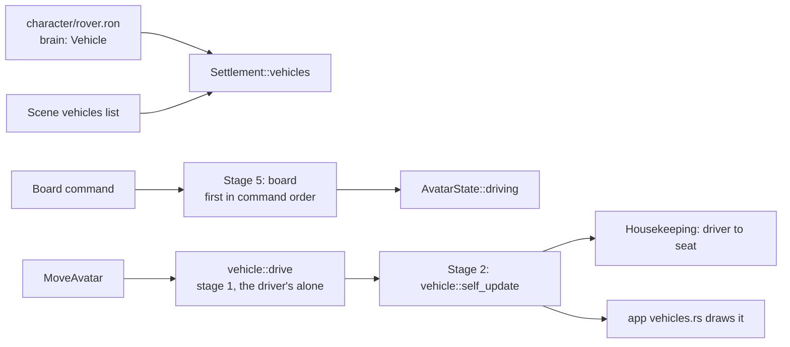

# Vehicles

A vehicle is a character a player climbs into and drives. The dig lab parks a mining **rover** beside the spawn: walk up to it and press **G** (or click the left stick) to climb in, steer with the movement controls, hold run to boost, and press G again to climb out. The rover rolls up the mine's quarter-meter terraces and out of a one-layer pit, drops off ledges, and stops at a mesa's cliff.

## How a vehicle fits the character framework

| Part | What a vehicle uses |
| --- | --- |
| Definition | A character file with `brain: Vehicle`, a `body` radius, `movement` speeds (walk is top speed, run is boost), and a `vehicle` tuning section. See [character definitions](character-definition.md). |
| State | Its own table, `Settlement::vehicles`, as threats have theirs. Each `VehicleState` stores its `CharacterIx`, so definitions stay out of state. An index is stable for the world's life. |
| Who drives | `AvatarState::driving` on the driver is the only link. A vehicle with nobody in it lets go of its controls. Leaving, dying and respawning end the link with no extra bookkeeping. |
| Commands | Movement commands are unchanged: while the link is set, `vehicle::drive` turns them into the vehicle's controls. Only `Board` is new. |
| Ownership | The vehicle is lent to its driver. Only the driver writes its controls, in stage 1, so they need no message. Boarding is a message (`Board`), because two players may reach for one seat on the same tick, and stage 5 seats the first in command order. |
| Prediction | `AvatarReplay` copies the driven vehicle and runs it with the driver, so driving is predicted with the simulation's own code. Climbing in waits for stage 5 and isn't predicted. Climbing out is. |
| Saves and hashes | Vehicles are saved and hashed with the settlement (save format 22), and character indices are remapped by name on load. |

## Driving rules

`sim/src/settlement/vehicle.rs` drives in `Fx`, like everything else in the simulation:

- **Steering:** the stick is a direction on the ground. The rover turns toward it and speeds up toward the stick's length times top speed. If the stick points more than 120° from the heading, it backs up, swinging the rear toward the stick. Turning needs rolling: full rate from a third of top speed.
- **Ground:** four wheels sample `Terrain::ground`. A move or turn that would lift any wheel more than `climb` (0.55 m for the rover), or put one over the arena edge, doesn't happen, and the rover loses that speed. Drops are fine.
- **Height:** the chassis rests on the wheels' mean height. It rises toward it at `lift` and falls at `gravity` when the ground drops away.
- **Collision:** discs (obstacles, cover) and rock columns push it out like an avatar's body, at the rover's `body.radius`.

## The crawler

The Crawler Lab parks a **crawler** (`character/crawler.ron`, design in [`CRAWLER.md`](../CRAWLER.md)): a vehicle with a `crawler` section that walks on four feet instead of rolling. It boards, drives and seats its pilot as the rover does; `sim/src/settlement/crawler.rs` moves it, in `Fx`:

- **State:** `VehicleState::legs` holds four feet (where each stands on which floor, or where it swings to) and the gait's clock (save format 47).
- **Gait:** a wave walk, one leg at a time with three down, and a diagonal trot on boost. Each leg lifts at the start of its slice of the cycle; backing up runs the wave the other way. Turning in place steps the feet sideways round the middle.
- **Footholds:** a lifting foot lands on the floor nearest its resting spot ahead of the body, within reach of its hip, at most 1.5 m up or down, with at most 2 m of gap on the way, and never on an elder, sprite or hauler. With none, it stays down, and the body stops where that foot can't reach any further.
- **Body:** level, its height easing to its feet's mean floor, sinking when a foot far below needs it. Ground under its box higher than its belly (1.2 m under the deck) stops it, as the mesa's 2 m cliff does.

`Settlement::validate` checks the planted feet are in reach and the gait's feet in the air; `validate_footholds` checks they stand on floors.

## Drawing

`app/src/vehicles.rs` draws each vehicle as a chassis, hood, roll bar and four wheels. The local player's rover is drawn from the player's own drawn transform, so the predicted driver and their rover never drift apart. Other rovers are interpolated between ticks. Each wheel eases onto the ground under it and the chassis tilts to them, so a terrace step lifts the front, then the back.

A crawler is drawn from its rig, `app/actors/crawler.ron` (`app/src/crawler.rs`): the body's boxes and cylinders (timber hull, brass cab and helm, a railed cargo deck) and one leg's hip, thigh, shin and foot, mirrored to the four. Each leg is a two-bone solve from its hip on the deck to the ankle over the sim's foot, the foot upright under it and the knee bending up and outward; a foot out of reach eases the leg straight instead of snapping. A swinging foot rises over the higher of its two floors, crosses at the gait's `lift` and comes down onto its landing spot. Feet and body are interpolated between ticks; a foot the sim aims again glides to its new spot. While the local player pilots a crawler the camera's view widens by `PILOT_PULL` (1.4) and eases back after they climb down.

## Current limits

- Rovers don't collide with avatars, haulers, threats or each other.
- Clicking a point to drive to stops the rover instead of routing there.
- The driver stands at the seat in their idle pose, and there's no on-screen "press G" prompt.
- The rover is a built-in mesh and the crawler a built-in rig, not style skins.

`kestrel/todo/vehicles.md` lists these as tasks.
