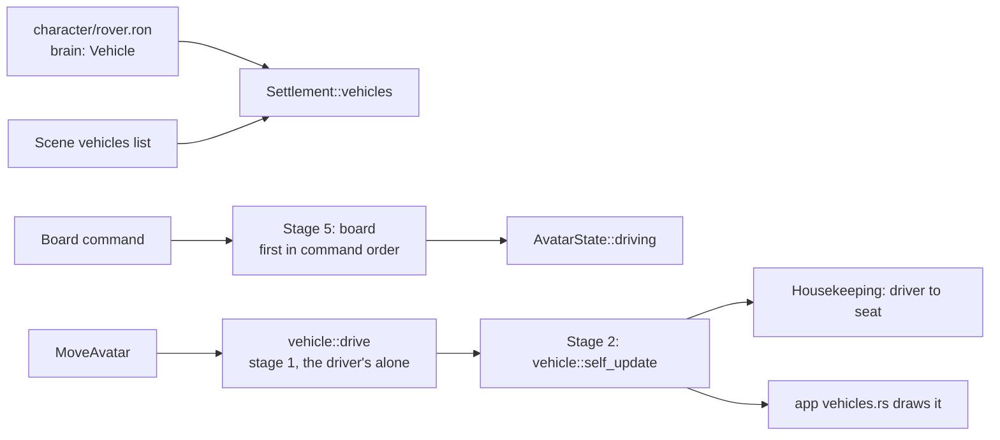

# Vehicles

A vehicle is a character a player climbs into and drives. The dig lab parks a mining **rover** beside the spawn: walk up to it and press **G** (or click the left stick) to climb in, steer with the movement controls, hold run to boost, and press G again to climb out. The rover rolls up the mine's quarter-meter terraces and out of a one-layer pit, drops off ledges, and stops at a mesa's cliff.

## How a vehicle fits the character framework

| Part | What a vehicle uses |
| --- | --- |
| Definition | A character file with `brain: Vehicle`, a `body` radius, `movement` speeds (walk is top speed, run is boost), and a `vehicle` tuning section. See [character definitions](character-definition.md). |
| State | Its own table, `Settlement::vehicles`, as threats have theirs. Each `VehicleState` stores its `CharacterIx`, so definitions stay out of state. An index is stable for the world's life. |
| Who drives | `AvatarState::driving` on the driver is the only link. A vehicle with nobody in it lets go of its controls. Leaving, dying and respawning end the link with no extra bookkeeping. |
| Commands | Movement commands are unchanged: while the link is set, `vehicle::drive` turns them into the vehicle's controls. Only `Board` is new. |
| Ownership | The vehicle is lent to its driver. Only the driver writes its controls, in stage 1, so they need no message. Boarding is a message (`Board`), because two players may reach for one seat on the same tick, and stage 5 seats the first in command order. |
| Prediction | `AvatarReplay` copies the driven vehicle and runs it with the driver, so driving is predicted with the simulation's own code. Climbing in waits for stage 5 and isn't predicted. Climbing out is. |
| Saves and hashes | Vehicles are saved and hashed with the settlement (save format 22), and character indices are remapped by name on load. |

## Driving rules

`sim/src/settlement/vehicle.rs` drives in `Fx`, like everything else in the simulation:

- **Steering:** the stick is a direction on the ground. The rover turns toward it and speeds up toward the stick's length times top speed. If the stick points more than 120° from the heading, it backs up, swinging the rear toward the stick. Turning needs rolling: full rate from a third of top speed.
- **Ground:** four wheels sample `Terrain::ground`. A move or turn that would lift any wheel more than `climb` (0.55 m for the rover), or put one over the arena edge, doesn't happen, and the rover loses that speed. Drops are fine.
- **Height:** the chassis rests on the wheels' mean height. It rises toward it at `lift` and falls at `gravity` when the ground drops away.
- **Collision:** discs (obstacles, cover) and rock columns push it out like an avatar's body, at the rover's `body.radius`.

## The crawler

The Crawler Lab parks a **crawler** (`character/crawler.ron`, design in [`CRAWLER.md`](../CRAWLER.md)): a vehicle with a `crawler` section that walks on four feet instead of rolling. It boards, drives and seats its pilot as the rover does; `sim/src/settlement/crawler.rs` moves it, in `Fx`:

- **State:** `VehicleState::legs` holds four feet (where each stands on which floor, or where it swings to) and the gait's clock (save format 47).
- **Gait:** a wave walk, one leg at a time with three down, and a diagonal trot on boost. Each leg lifts at the start of its slice of the cycle; backing up runs the wave the other way. Turning in place steps the feet sideways round the middle.
- **Footholds:** a lifting foot lands on the floor nearest its resting spot ahead of the body, within reach of its hip, at most 1.5 m up or down, with at most 2 m of gap on the way, and never on an elder, sprite or hauler. With none, it stays down, and the body stops where that foot can't reach any further.
- **Body:** level, its height easing to its feet's mean floor, sinking when a foot far below needs it. Ground under its box higher than its belly (1.2 m under the deck) stops it, as the mesa's 2 m cliff does.

### Pilot and riders

A crawler has four seats: the pilot's at the helm on the deck's middle, and three riders' places on the cargo deck behind it (`crawler::RIDERS`: 0.75 m back and 0.7 m to each side, and 2.4 m back on the middle). A rider is `Seat::Rider { vehicle, place }` (save format 48); the pilot is `Seat::Vehicle` as a rover's driver.

- **Boarding:** G reaches a crawler within 0.8 m (`BOARD_REACH`) past the elder's body of its 6 x 3 m box, not a radius, so from any side or end. It takes the cab if it's free, else the free place on the deck nearest the elder. Stage 5 seats players in command order, so on one tick the first gets the cab and the next three the deck; a fifth gets nothing.
- **Riding:** housekeeping keeps each rider in their place, facing the crawler's way, at the deck's height. A rider's movement does nothing: only the pilot steers, and a crawler whose pilot climbed down stands still with its riders aboard. Riders are out of the feet's way (`crawler::standing` skips anyone seated).
- **Climbing down:** G again puts the elder by the box, 0.15 m past it beyond their radius: their seat's own spot first, so four climbing down together land apart (the pilot's beside the middle on the left, a front rider's beside the back on their side, the back rider's behind), then their seat's side level with the middle, toward the back and the front, then the other side, then behind and in front. A spot must be in the arena, clear of discs and rock, clear of every foot's spot and of the spot each swinging foot will land on, and on a floor within 0.6 m of the highest floor its feet stand on, so never down a trench or a pit, even with a foot down in it. With none, the elder stays aboard.
- **Prediction:** a rider's client runs the crawler alongside the rider on its confirmed controls, as if the pilot held their stick: exact until the pilot's next command reaches it. Climbing down is predicted, as the driver's.

### Feet and bodies

A foot coming down matters to whoever stands there (C10, `crawler.rs`):

- **Shove:** stage 2 notes the feet that came down (`Settlement::landings`), stage 3 lists the agents and threats under each, within the foot's 0.4 m (`FOOT_RADIUS`) plus their radius and on its floor (within 1 m), as a `FootLands` message (save format 49 for its queue), and stage 5 applies it after the threats' swings. An elder, sprite or hauler still under it is put just clear of the foot, 0.1 m past touching (`SHOVE_GAP`), away from it (or from the crawler's middle if it stood on the spot itself), else turned by eighths of a turn: on a floor it can walk to, clear of discs, rock and every foot. An elder shoved stops digging. With nowhere to go it stays.
- **Stomp:** a threat under it loses `STOMP_DAMAGE` (4) hit points, armor or not, more than a ghoul has; at 0 it dies as a strike's kill (`Event::Hit` with `Impact::Stomp`, a kill counted). One that lives is thrown off at 4 m/s and staggered 0.4 s.
- **Skipped:** the pilot and riders, seated on the deck, are never under a foot, and a sprite inside a building isn't there. A foot never comes down on an elder, sprite or hauler it saw standing when it lifted (`foothold`); only one that walked under it since is shoved. Ghouls don't attack the crawler.
- **Paths:** bodies path round its feet, not its body, which is overhead: an elder's click-to-move route, a ghoul's chase and its route home when it plans again, and haulers' and sprites' detours round traffic take a disc at every foot's spot (planted, or where a swing lands) level with them, except one they already touch. A wave's route, planned once for all its enemies, doesn't.
- **View:** each footfall is an `Event::Footfall` (shoved, stomped). The view raises a puff of dust under the foot with a step's sound; a shove rings it with a little more dust, and a stomp with a ring of six bursts and a heavy landing (`vehicles::footfalls`). The stomped ghoul bleeds and falls as any kill.

`Settlement::validate` checks the planted feet are in reach and the gait's feet in the air; `validate_footholds` checks they stand on floors.

## Drawing

`app/src/vehicles.rs` draws each vehicle as a chassis, hood, roll bar and four wheels. The local player's rover is drawn from the player's own drawn transform, so the predicted driver and their rover never drift apart. Other rovers are interpolated between ticks. Each wheel eases onto the ground under it and the chassis tilts to them, so a terrace step lifts the front, then the back.

A crawler is drawn from its rig, `app/actors/crawler.ron` (`app/src/crawler.rs`): the body's boxes and cylinders (timber hull, brass cab and helm, a railed cargo deck) and one leg's hip, thigh, shin and foot, mirrored to the four. Each leg is a two-bone solve from its hip on the deck to the ankle over the sim's foot, the foot upright under it and the knee bending up and outward; a foot out of reach eases the leg straight instead of snapping. A swinging foot rises over the higher of its two floors, crosses at the gait's `lift` and comes down onto its landing spot. Feet and body are interpolated between ticks; a foot the sim aims again glides to its new spot. While the local player pilots or rides a crawler the camera's view widens by `PILOT_PULL` (1.4) and eases back after they climb down. Riders are drawn in their places on the cargo deck, which the rig keeps clear: the crates sit across its middle, between the front two places and the back one. A local rider's crawler is drawn from the rider's own drawn transform, less their place, so the two never drift apart.

## Current limits

- Rovers don't collide with avatars, haulers, threats or each other. A crawler's feet shove and stomp, but bodies walking by hand (the stick) pass through a planted foot; only planned routes go round it.
- Clicking a point to drive to stops the rover instead of routing there.
- The driver and a crawler's riders stand at their seats in their idle pose, and there's no on-screen "press G" prompt.
- The rover is a built-in mesh and the crawler a built-in rig, not style skins.

`kestrel/todo/vehicles.md` lists these as tasks.
